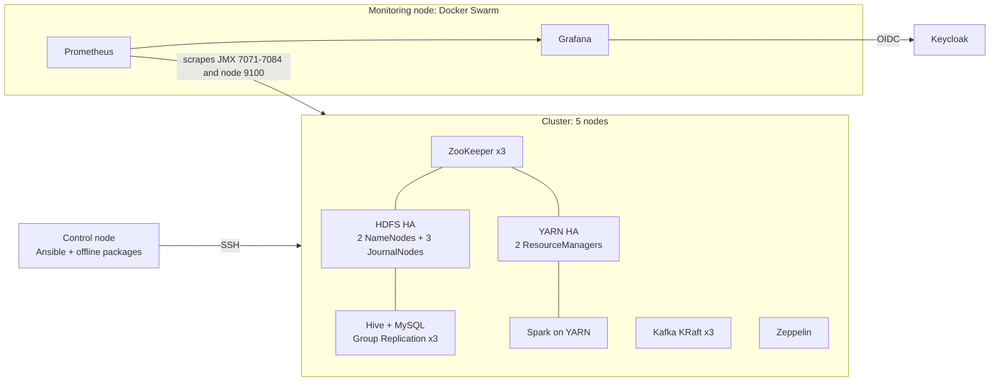
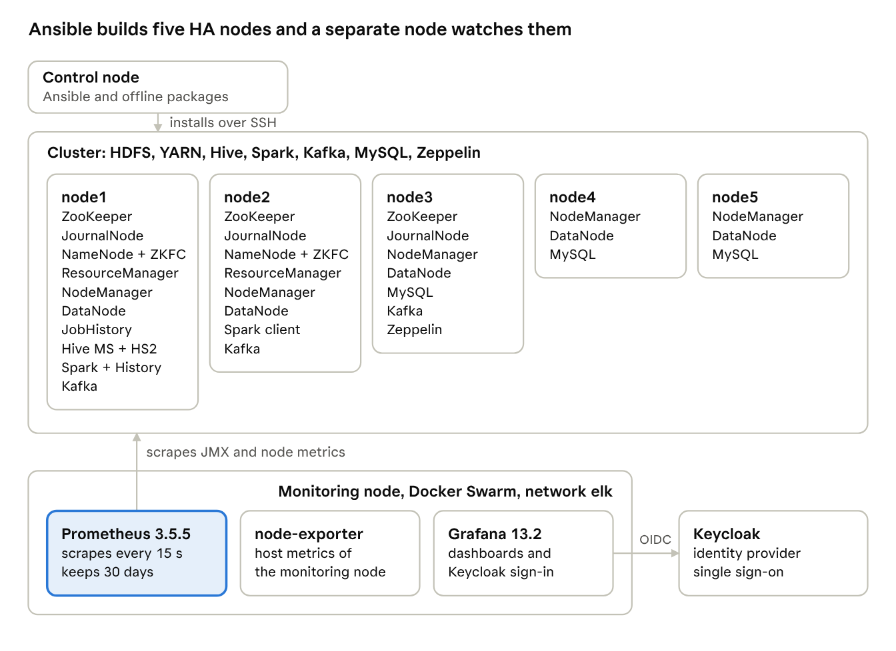

# hadoop-ha-ansible-observability

> **A five-node, high-availability Hadoop platform installed offline with one Ansible project, and watched from a separate Docker Swarm node with Prometheus and Grafana.** Inventory-driven monitoring targets, masked configs, starter alerts, dashboard tooling, **every bug we hit and how it was fixed**, and an honest list of what is still open.


This repository is the write-up and the tooling of a real build. Everything specific to the original company (domain, hosts, IPs, users, secrets) has been replaced by placeholders. See [docs/prerequisites.md](docs/prerequisites.md#masking-legend).

## What was built





| Layer | What | Where to read | Automation |
|---|---|---|---|
| Coordination | ZooKeeper 3.8.4 (3-member quorum) | [docs/services/zookeeper.md](docs/services/zookeeper.md) | [`ansible/roles/zookeeper`](ansible/roles/zookeeper) |
| Storage | HDFS, two NameNodes, ZKFC, three JournalNodes | [docs/services/hdfs.md](docs/services/hdfs.md) | [`ansible/roles/hadoop`](ansible/roles/hadoop) |
| Compute | YARN, two ResourceManagers | [docs/services/yarn.md](docs/services/yarn.md) | same role |
| Metastore DB | MySQL 8.0.42 Group Replication | [docs/services/mysql-group-replication.md](docs/services/mysql-group-replication.md) | [`ansible/roles/mysql`](ansible/roles/mysql) |
| SQL and batch | Hive 3.1.3, Spark 3.5.4 | [hive](docs/services/hive.md), [spark](docs/services/spark.md) | [`roles/hive`](ansible/roles/hive), [`roles/spark`](ansible/roles/spark) |
| Streaming | Kafka 4.0.0 in KRaft mode | [docs/services/kafka.md](docs/services/kafka.md) | [`ansible/roles/kafka`](ansible/roles/kafka) |
| Notebooks | Zeppelin 0.12.1 | [docs/services/zeppelin.md](docs/services/zeppelin.md) | [`ansible/roles/zeppelin`](ansible/roles/zeppelin) |
| Metrics | JMX exporter on every JVM, node, MySQL, Kafka, cAdvisor exporters | [docs/monitoring/jmx-exporters.md](docs/monitoring/jmx-exporters.md) | [`ansible/roles/jmx_exporter`](ansible/roles/jmx_exporter), [`monitoring/exporters`](monitoring/exporters) |
| Monitoring | Prometheus 3.5.5 and Grafana 13.2.0 on Docker Swarm | [docs/monitoring/prometheus-grafana-stack.md](docs/monitoring/prometheus-grafana-stack.md) | [`monitoring/`](monitoring), [`scripts/monitoring/`](scripts/monitoring) |

## Highlights

- **One inventory, no hard-coded addresses.** Quorums, `nn1/nn2`, `rm1/rm2`, ZooKeeper `myid` and Kafka `node.id` are computed from group membership.
- **Offline and safe by default.** No internet needed; destructive actions need an explicit flag; HDFS, MySQL and the tarball installer refuse to wipe existing data.
- **Monitoring targets come from the inventory.** [`gen-targets.py`](monitoring/prometheus/gen-targets.py) writes the Prometheus `file_sd` files, so host names, roles and ports can never drift from the Ansible inventory.
- **Secrets stay out of files.** Grafana secrets are Docker Swarm secrets; Ansible secrets are Vault-encrypted and git-ignored.
- **Dashboards as code.** Export, sanitize, commit, deploy: [`scripts/monitoring/`](scripts/monitoring).
- **Everything is checkable offline.** `bash scripts/tools/validate.sh` parses YAML, generates targets, tests the sanitizer, checks links and scans for secrets. CI runs the same.
- **Honest.** Every unverified statement is labelled; see [known limitations](docs/known-limitations.md).

## Quick start

```bash
git clone https://github.com/<you>/hadoop-ha-ansible-observability.git && cd hadoop-ha-ansible-observability

# 1. Install the cluster (offline packages go in ansible/offline_packages, see its MANIFEST.md)
cd ansible
vi inventory/production.yml                                     # the only per-cluster file
cp inventory/group_vars/all/secrets.yml.example inventory/group_vars/all/secrets.yml
vi inventory/group_vars/all/secrets.yml && ansible-vault encrypt inventory/group_vars/all/secrets.yml
make preflight && make install && make status
cd ..

# 2. Deploy monitoring on the Swarm node (details: monitoring/README.md)
MON_HOST=<NOC_HOST> CLUSTER_NAME=<cluster-name> bash scripts/monitoring/deploy-config.sh
```

> **Honesty note.** The Ansible project was validated statically (YAML, Jinja, safety assertions) but its live failover behaviour was not measured in the original build environment. The reference exporters (node, MySQL, Kafka, cAdvisor) and the deploy and export scripts are *unverified* against live systems. Read each script before running it.

## Repository layout

```
ansible/       the deployment project (roles, playbooks, inventory, tests); see ansible/README.en.md
monitoring/    Swarm stack, Prometheus config and target generator, alert rules, Grafana provisioning, dashboards, exporters
docs/          architecture, one page per service, monitoring, operations, security; plus the Word guide in docs/guide
scripts/       monitoring/ (deploy, export and sanitize dashboards) and tools/ (validate, secret scan)
tests/         fixtures for the offline checks
.github/       CI and the pull request template
```

## Documentation

Start at the [documentation index](docs/README.md). Highlights:

- [Architecture](docs/architecture.md) and [HDFS failover](docs/services/hdfs.md)
- [Prometheus and Grafana stack](docs/monitoring/prometheus-grafana-stack.md) and [dashboards](docs/monitoring/grafana-dashboards.md)
- [Verification and failover tests](docs/verification-and-failover.md)
- [Troubleshooting: problems and fixes](docs/troubleshooting.md)
- [Known limitations](docs/known-limitations.md), [security checklist](docs/security-checklist.md), [roadmap](docs/roadmap.md)
- [Adding a service to monitoring](docs/adding-a-service.md)
- The [same content as one Word document](docs/guide/)

The companion repository `enterprise-sso-keycloak` covers the Keycloak single sign-on used by Grafana, Knox and Zeppelin.

## Safety rules for contributors

1. Never commit real values. Put your real domain and hosts in the git-ignored `.forbidden-terms` file and run `bash scripts/tools/validate.sh` before every commit.
2. Label unverified statements as such.
3. Every bug goes into [troubleshooting](docs/troubleshooting.md), every limitation into [known limitations](docs/known-limitations.md).

See [CONTRIBUTING.md](CONTRIBUTING.md) and [SECURITY.md](SECURITY.md).

## License

MIT, see [LICENSE](LICENSE).
