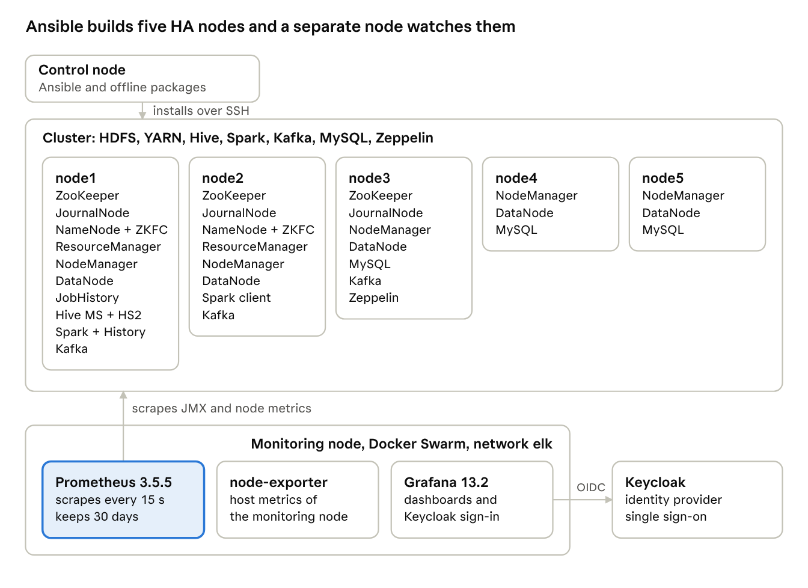

# Architecture

[← Documentation index](README.md)

The platform has three parts: a control node that installs everything, five cluster nodes that run the services, and a monitoring node that sits outside the cluster.

Ansible runs from the control node over SSH. Prometheus on the monitoring node pulls metrics from every cluster node, and Grafana signs users in through Keycloak.

## Why this shape

- **Roles are shared, not one per machine.** Node1 and node2 carry the coordination and master roles, node3 adds the MySQL replica and the notebook server, and node4 and node5 are plain workers with a MySQL replica. Five machines carry all the services listed in [Environment, prerequisites and masking conventions, 3.2](prerequisites.md#servers-involved).

- **Every quorum has an odd number of members.** ZooKeeper, the JournalNodes and Kafka controllers use three, and MySQL Group Replication uses three. Each survives the loss of one member.

- **Active and standby pairs where a single master exists.** The two NameNodes and the two ResourceManagers each elect an active member through ZooKeeper.

- **Monitoring lives apart from the cluster.** A cluster outage must not take the dashboards with it, so Prometheus and Grafana run on their own Swarm node.

## What depends on what

| Layer      | Depends on                                           |
|------------|------------------------------------------------------|
| HDFS HA    | ZooKeeper (election), JournalNodes (shared edit log) |
| YARN HA    | ZooKeeper (election), HDFS (job staging)             |
| Hive       | HDFS (warehouse), MySQL (metastore), YARN            |
| Spark      | YARN, HDFS, Hive Metastore                           |
| Zeppelin   | Spark, Hive                                          |
| Kafka      | Nothing else. KRaft replaces ZooKeeper               |
| Monitoring | JMX agents and exporters on every node               |

This is also the install order in [The Ansible project, 4.4](ansible-project.md#run-order): coordination first, storage next, then engines on top.
