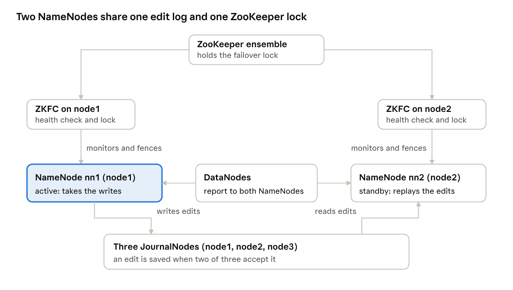

# HDFS high availability

[← Documentation index](../README.md)

HDFS provides the shared file system. The NameNode is the directory of every file, so it is the single point of failure that high availability removes.

## Components and where they run

| Component           | Nodes               | Job                                                                      |
|---------------------|---------------------|--------------------------------------------------------------------------|
| NameNode (nn1, nn2) | node1, node2        | Holds file system metadata. One is active, one is standby                |
| JournalNode         | node1, node2, node3 | Stores the shared edit log. A write succeeds when two of three accept it |
| ZKFC                | node1, node2        | Watches its NameNode and fights for the ZooKeeper lock                   |
| DataNode            | node1 to node5      | Stores the blocks                                                        |

The name service is \<cluster\>-ha. Clients talk to that name, not to a single host, and the failover proxy finds the active NameNode.

The active NameNode writes every change to the JournalNodes and the standby reads them. Each ZKFC watches its own NameNode and competes for the ZooKeeper lock, so only one NameNode is active at a time.

## How a failover works

1.  The active NameNode writes every change to the JournalNodes.

2.  The standby reads those edits continuously, so it is always almost current.

3.  If the active NameNode stops, its ZKFC loses the ZooKeeper lock.

4.  The other ZKFC takes the lock. Before promoting its NameNode it fences the old one: first sshfence as the hadoop user, then shell(/bin/true) as a fallback, so a dead host cannot block the promotion.

5.  The standby becomes active, normally within 15 to 30 seconds.

## Bootstrap sequence (bootstrap-ha.yml)

1.  Start the three JournalNodes.

2.  On the first NameNode: check whether it is already formatted. If not, check that no JournalNode data exists, then format it.

3.  Initialise the HA znode in ZooKeeper (hdfs zkfc -formatZK). A return code of 2 means it already exists and is accepted.

4.  Start the first NameNode and wait for RPC on port 8020.

5.  On the second NameNode: copy the metadata from the active one (bootstrapStandby) and start it. The role then confirms it stays up and answers RPC. A standby listens on RPC like an active node, so "unit is active" alone is not accepted as health.

6.  Start ZKFC on both NameNodes and check port 8019.

7.  Start the DataNodes and create the base directories (/tmp, /user, /user/history, and the Hive warehouse).

Formatting happens only when no metadata exists. Re-formatting needs hdfs_force_reformat=true and confirm_destroy_data=yes.

## Key settings

| Setting                    | Value                                                             |
|----------------------------|-------------------------------------------------------------------|
| Replication factor         | The smaller of 3 and the number of DataNodes                      |
| ZooKeeper session timeout  | 10 000 ms                                                         |
| NameNode RPC, HTTP, HTTPS  | 8020, 9870, 9871                                                  |
| JournalNode RPC, HTTP      | 8485, 8480                                                        |
| ZKFC RPC                   | 8019                                                              |
| DataNode data, HTTP, HTTPS | 9866, 9864, 9865                                                  |
| Directories                | /data/hadoop/nn, /data/hadoop/dn, /data/hadoop/jn                 |
| Service units              | hadoop-journalnode, hadoop-namenode, hadoop-zkfc, hadoop-datanode |

## HTTPS for the web interfaces

hadoop_ssl_enabled: true runs ssl.yml. In selfsigned mode each node gets its own key pair with its inventory name, OS host name and IP in the certificate names. The certificates are gathered on the control node, distributed to every node and imported into each truststore. In custom mode the operator supplies PEM files that are converted to PKCS12. Self-signed mode is meant for internal use and testing.

## Verify

sudo -u hadoop hdfs haadmin -getAllServiceState \# one active, one standby  
sudo -u hadoop hdfs dfsadmin -report \# all DataNodes live  
sudo -u hadoop hdfs dfs -ls /
